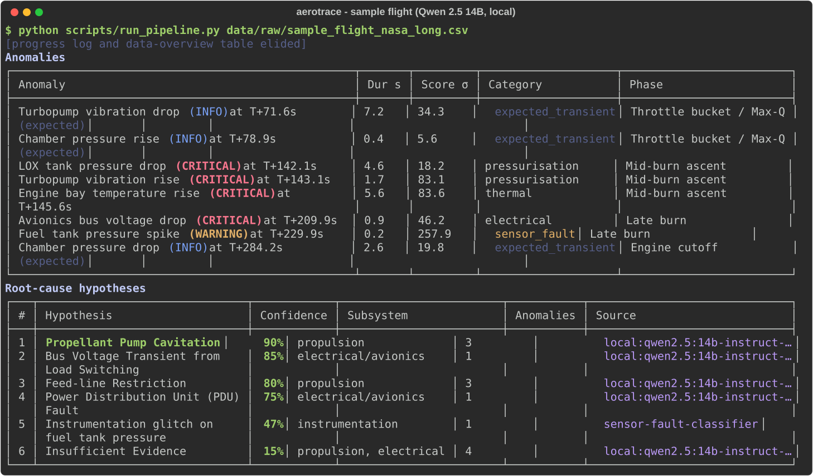

# AeroTrace-RCA

**Local-first root-cause analysis for launch-vehicle telemetry: statistical anomaly detection, then hypotheses from a
local LLM (Qwen 2.5 14B via Ollama) that are checked against sensor evidence and a physical coupling table.**

Local by default (Qwen 2.5 14B via Ollama); optional Claude fallback via `ANTHROPIC_API_KEY`, off unless you set it. Every hypothesis cites the anomalies it explains, and the validator rejects causes
the telemetry cannot support.



<sub>Real output from `scripts/run_pipeline.py` on the bundled sample flight (progress log and data-overview table
elided). The run also writes a Markdown report, a JSON export, plots and a decision log.</sub>

---

## Quick start

Requires Docker with an NVIDIA GPU (≥ 12 GB VRAM) and the
[NVIDIA Container Toolkit](https://docs.nvidia.com/datacenter/cloud-native/container-toolkit/) (Linux), or Docker
Desktop with WSL2 GPU support (Windows).

```bash
git clone https://github.com/<you>/AeroTrace-RCA.git && cd AeroTrace-RCA
docker compose up -d
docker exec -it aerotrace python scripts/run_pipeline.py
```

- **First `up`:** builds both images and bakes Qwen 2.5 14B Q4 and `nomic-embed-text` into the Ollama image
  (~9.5 GB download, once). On first start the app container embeds the knowledge base (~1 min).
- **Your data:** put files in `./data/raw/` and run
  `docker exec -it aerotrace python -m src.main data/raw/<file> --report`. Reports appear in `./data/reports/`.
- **CPU only:** `docker compose -f docker-compose.yml -f docker-compose.cpu.yml up -d`. Expect several minutes per
  LLM call.

<details>
<summary>Without Docker</summary>

```bash
python scripts/setup_env.py                        # .venv + requirements + .env  (Python 3.11+)
ollama pull qwen2.5:14b-instruct-q4_K_M && ollama pull nomic-embed-text
python scripts/build_knowledge_base.py             # embed the 102-case knowledge base
python scripts/run_pipeline.py                     # generates a sample flight if data/raw/ is empty
python -m src.main --test                          # offline end-to-end self-test (no LLM)
pytest                                             # 162 tests, fake LLM clients
```
</details>

---

## What it does

```
telemetry ─► ingest ─► analyst ─► detector ─► sensor-fault ─► triage ─► RAG ─► hypotheses ─► validator ─► report
(.csv/.json   normalise  stats,     5 detectors  classifier     (Qwen)    102     (Qwen)        evidence +   Markdown,
 /.fits)      impute     phases,    + onset,                              cases                coupling     JSON, plots,
                         correlate  recovery                                                   rules        decision log
```

**Ingestion**
- Long (NASA-style) and wide-format (one row per timestamp, one column per channel) CSV, JSON / JSON-Lines / channel documents, and FITS binary tables.
- ISO-8601, epoch or relative (`T+12.5`) timestamps.
- Gaps are interpolated and flagged.

**Detection** (`src/agents/anomaly_detector.py`)
- **Five detectors per sensor:** robust z-score against a rolling-median trend, moving-average deviation, derivative
  z-score, hard limits, and a **slow-shift channel**. Slow shift compares the smoothed value with its value 5 s and
  10 s earlier, minus the drift the preceding 10 s slope predicts, in sigmas of that sensor's normal drift. It
  catches gradual level shifts that the rolling median absorbs.
- **Onset backtracking:** an event is dated to where the deviation began, not where it crossed the threshold.
- **Recovery label:** each event is marked *transient* (back within 1σ of the extrapolated trend within 10 s) or
  *sustained* (settled value reported).
- **Severity:** graded in sigma, with per-sensor relative-change floors (e.g. pressure > 5 % → at least WARNING).
  Slow shifts are graded on their total magnitude.
- **Expected events:** planned transients (engine start, throttling, MECO) are marked expected, and detections in
  the first 5 s are suppressed.

**Triage and context**
- **Sensor-fault classifier:** separates 1-sample instrumentation glitches from real events before any reasoning.
- **Telemetry analyst:** tags flight phases and builds correlation groups of anomalies within 5 s of each other.
- **Historical RAG:** retrieves the 5 most similar of 102 failure cases (82 synthetic across 8 subsystems, plus 20
  real incidents) and adds them to the prompt as prior art. Cases in the leading anomaly group's category get a
  ranking bonus.

**Hypothesis generation and validation** (`hypothesis_generator.py`, `evidence_rules.py`)
- **Hypothesis types:** Qwen must give at least 2 competing explanations, each a `root_cause`,
  `independent_events` or `insufficient_evidence`, with distinguishing evidence.
- **Validator checks.** Every hypothesis must pass:
  - **Citations:** anomalies are cited by label, and the hypothesis text must mention each cited sensor and time.
    Expected transients and sensor glitches can't be cited.
  - **Topic and phase:** the title must not name a sensor whose anomaly isn't cited, and any flight phase it names
    must match a cited anomaly.
  - **Rule 1, evidence:** a named component needs anomalies on its sensors (cavitation needs turbopump vibration
    **and** a tank pressure). A named subsystem needs an anomaly from that subsystem.
    - *Local unit faults* (IMU, camera, star tracker, battery cell) only need their own sensor.
    - Causes with no sensor coverage are capped at 30 % confidence.
  - **Rule 2, coupling:** a cross-subsystem causal chain must follow a direct link in the coupling table.
  - **Mechanism check:** a hypothesis that mixes mechanisms from two subsystems needs evidence from both.
  - **Time gap:** links between anomalies more than 30 s apart have their confidence halved (capped at 30 %) unless
    the delay is explained.
- **Follow-ups for unexplained anomalies:** first a focused prompt (with an explicit independence instruction when
  needed), then a single-cause prompt. If both fail, an `Unresolved – manual review` placeholder is added. Nothing is
  silently dropped.
- **Fallback:** if the LLM is unavailable, rule-based hypotheses are generated and pass through the same validator.

**Output**
- **Report:** Markdown with a timeline, findings, ranked hypotheses, recommendations and methodology, plus a
  one-page summary, JSON and plots.
- **Decision log:** a JSON file of every routing decision, rejection, follow-up and confidence cap.
- **Reproducibility:** Ollama runs at temperature 0 with a fixed seed. With `OLLAMA_REPRODUCIBLE=true` the model is
  reloaded per call, so identical input gives identical output. The KV-cache state otherwise changes the wording.

---

## Evaluation results

All evaluation flights are synthetic 300 s ascents (10 Hz, 7–8 channels, realistic noise and drift) with injected
faults, generated by `scripts/generate_eval_flights.py`. Ground truth is written and committed **before** each
held-out set is run, and no code changes are made between generating a set and running it.

| Set | Flights | Detection | Root cause ranked #1 | Fully correct¹ | False positives |
|---|---|---|---|---|---|
| Regression (tuning flights) | 6 | 13/13 | **6/6 (100 %)** | 6/6 | 0 |
| Final held-out (seeds 401–405, blind) | 5 | 8/8 | **3/5 (60 %)** | 1/5 (20 %) | 3 |

¹ Correct #1, every real anomaly explained, no false causal links, no false-positive anomalies.

- **Regression:** the sample flight plus the cases the system was tuned on. It covers a fuel-turbopump cascade, a
  thermal-only fault, an electrical cascade, a nominal flight and two independent faults. These are not a measure
  of generalisation.
- **Held-out, final run:**
  - ✅ LOX leak with bay cooling, ✅ slow injector clog, ✅ IMU internal fault.
  - ❌ Regulator under-pressure: the #1 was feed-line restriction, a knowledge-base case it over-matched.
  - ❌ Bus droop plus bearing wear: the two independent faults were linked through the electrical → propulsion
    coupling.
- **Earlier held-out set:** the previous set (seeds 301–305) scored 40 % on first contact. After fixes made with
  knowledge of its failures it reached 60 %, but that figure is optimistic. The final set above was never seen
  before its run.

Reproduce:

```bash
OLLAMA_REPRODUCIBLE=true python scripts/evaluate_generalization.py --truth data/eval/ground_truth.json
python scripts/generate_eval_flights.py --set final
OLLAMA_REPRODUCIBLE=true python scripts/evaluate_generalization.py --truth data/eval_final/ground_truth.json
```

Scoring rules are stored in each `ground_truth.json`.

---

## Example output

The bundled sample flight injects a LOX pressurisation drop at T+142 s with a cascade, an independent bus sag at
T+210 s, and a single-sample fuel-pressure glitch at T+230 s. This is an excerpt of the generated report.

**Timeline**

| MET | Anomaly | Duration | Baseline → peak | Category |
|---|---|---|---|---|
| T+142.1s | 🔴 LOX tank pressure drop (CRITICAL) | 4.6 s | 48.92 → 43.01 psi | pressurisation |
| T+143.1s | 🔴 Turbopump vibration rise (CRITICAL) | 1.7 s | 2.103 → 8.18 g | pressurisation |
| T+145.6s | 🔴 Engine bay temperature rise (CRITICAL) | 5.6 s | 98.98 → 136.2 °C | thermal |
| T+209.9s | 🔴 Avionics bus voltage drop (CRITICAL) | 0.9 s | 27.85 → 26.01 V | electrical |
| T+229.9s | 🟠 Fuel tank pressure spike (WARNING) | 0.2 s | 43.8 → 68.71 psi | sensor_fault |

**Ranked hypotheses**

| # | Hypothesis | Confidence | Explains |
|---|---|---|---|
| 1 | Propellant Pump Cavitation | 90 % | LOX drop → vibration → bay heating |
| 2 | Bus Voltage Transient from Load Switching | 85 % | bus sag (independent) |
| 3 | Feed-line Restriction | 80 % | LOX drop → vibration → bay heating |
| 4 | Power Distribution Unit (PDU) Fault | 75 % | bus sag |
| 5 | Instrumentation glitch on fuel tank pressure | 47 % | fuel spike (sensor-fault classifier) |
| 6 | Insufficient Evidence | 15 % | – (confidence halved: cites anomalies 65 s apart) |

**H1. Propellant Pump Cavitation (90 %)**

> The LOX tank pressure drop at T+142.1s is the root cause, leading to cavitation in the turbopump [...] resulting
> in turbopump vibration rise at T+143.1s and subsequent engine bay temperature rise at T+145.6s.

H1 passes Rule 1 because cavitation needs a turbopump-vibration anomaly **and** a tank-pressure anomaly, and it
cites both. It passes Rule 2 because the chain follows pressurisation → propulsion → thermal. In the same run, the
validator rejected an `independent_events` hypothesis that cited a single anomaly, and cut an unexplained 65 s link
from 30 % to 15 %.

H3 is a weak alternative. A feed-line restriction would leave tank pressure nominal, but Qwen cites the LOX drop as
its evidence. The validator checks that the cited evidence exists, not whether the reasoning is right.

---

## Customization

All tuning lives in `config/agents.yaml`; no code changes are needed for a new vehicle.

**New vehicle**
- Set `telemetry_analyst.flight_phases`, `anomaly_detector.planned_events` and `anomaly_detector.sensor_limits`.
- Map each sensor to a subsystem in `historical_rag.sensor_categories`, or with glob `sensor_category_patterns`.
  Unmapped sensors get no couplings.
- Without this, engine start, throttling and cutoff will be reported as anomalies.

**Telemetry formats**
- CSV (long or wide), JSON and FITS are detected by file extension (`src/ingestion/__init__.py`).
- Column aliases (`mnemonic`, `channel`, `eng_value`, ...) and timestamp handling are set in `CSVParserConfig`.
- To add a format, write a parser that returns `list[TelemetryReading]` and register its extension in
  `SUPPORTED_SUFFIXES` / `load_telemetry`.

**Coupling table** (`hypothesis_generator.evidence_rules`)

```yaml
couplings:                      # directed cause -> effect; only direct links are accepted
  pressurization: [propulsion, structural, thermal]
  electrical: [avionics, thermal, propulsion]
components:                     # component-level evidence for Rule 1 (AND of OR-groups)
  turbopump_cavitation:
    terms: ["cavitat*"]
    requires: [[turbopump_vibration], [lox_tank_pressure, fuel_tank_pressure]]
local_units:                    # self-contained units judged on their own sensor
  imu: {terms: [imu], sensors: ["*imu*"], local_subsystems: [electrical, avionics]}
```

`subsystem_terms`, `mechanism_terms`, `sensor_evidence` and the confidence caps are in the same section.

**Knowledge-base cases**
- Add a case to `scripts/kb_sources/<category>.json`, then:

  ```bash
  python scripts/acquire_aerospace_data.py   # validates (250-350 words, required sections) and renders .txt
  python scripts/build_knowledge_base.py     # re-embeds into data/vector_store/
  ```

- Or drop a `.txt` with `Title:` / `Category:` / `Failure mode:` / `Source type:` headers into
  `data/historical_failures/<category>/`.
- Short failure-mode signatures for the in-prompt KB live in `SEED_FAILURE_MODES`
  (`src/memory/knowledge_base.py`).

**Prompts and models**
- **Prompts:** `CLASSIFIER_SYSTEM_PROMPT` (detector), and `SYSTEM_PROMPT` / `HYPOTHESIS_PROMPT_TEMPLATE` /
  follow-up templates (hypothesis generator).
- **Model:** `OLLAMA_MODEL` selects the model.
- **Optional Claude:** `ANTHROPIC_API_KEY` enables Claude as a fallback or preferred provider; leave it unset to
  stay fully local.

---

## Limitations

- **60 % top-1 accuracy on blind faults.** Treat the ranked list as a structured starting point for an
  investigation, not an answer. Every report must be reviewed by the responsible subsystem engineers before any
  flight-safety or hardware decision.
- **The coupling table checks possibility, not occurrence.** Two independent faults in coupled subsystems (e.g. bus
  sag and a tank-pressure drop) can still be merged into one causal chain; this happened on 2 of the last 10 blind
  flights.
- **The LLM anchors on retrieved cases.** Adding a well-matching knowledge-base case fixed one fault class and
  caused a misdiagnosis in a neighbouring one. The validator checks that cited evidence exists, not that the
  reasoning is sound, so weak alternatives can still score 70–80 %.
- **Detection edge cases:**
  - Half-normal vibration noise produces occasional single-sample false positives. They are usually classified as
    instrumentation glitches.
  - A second fault on the same sensor within ~10 s of a detected one is not reported separately.
  - Ramps much slower than ~15 s are untested.
- **Synthetic evaluation:** all scored flights are generated with one vehicle profile and 7–8 channels. Real vehicles
  have hundreds of channels, other failure dynamics and messier data; expect lower accuracy until the system is
  re-tuned and re-evaluated on real telemetry.
- **Small evaluation set:** 15 held-out flights across three sets, of which only the final 5 were unseen by the
  current code. With n = 5, the confidence interval on "60 %" is wide.

---

## Project layout

```
config/          settings.py (pydantic-settings), agents.yaml (all tuning)
src/agents/      telemetry_analyst, anomaly_detector, sensor_fault_classifier, hypothesis_generator,
                 evidence_rules, report_writer, supervisor
src/ingestion/   csv_parser (+ sample-flight generator), json_parser, fits_reader
src/memory/      vector_store, knowledge_base (seed failure modes), historical_rag (ChromaDB + nomic-embed-text)
scripts/         run_pipeline, build_knowledge_base, acquire_aerospace_data, generate_eval_flights,
                 evaluate_generalization
data/historical_failures/   102 knowledge-base cases (rendered from scripts/kb_sources/)
docker/, Dockerfile, docker-compose*.yml    app + Ollama images (models baked in, Ollama pinned to 0.34.4)
tests/           162 pytest tests (fake LLM clients; no GPU needed)
```

---

## License

MIT. See [LICENSE](LICENSE).
